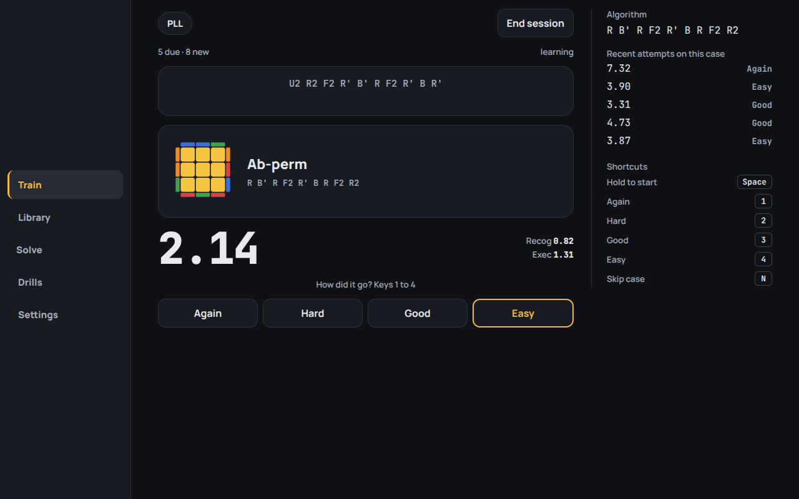

# Split



A speedcubing timer and algorithm trainer that keeps everything on the device: no account, no backend, no
tracking. Time solves with inspection and WCA penalties, then drill **PLL (21)**, **OLL (57)**, **F2L (41 cases
in 4 slots)** and **ZBLL (472)** with recognition and execution timing, case-specific scrambles, spaced
repetition and diagrams generated from the algorithms themselves.

One Svelte 5 + TypeScript codebase, three shells: browser/PWA, Android (Capacitor), desktop (Tauri).

## Features

- **Solve:** hold to start, optional 15 s inspection (warns at 8 and 12 s, +2 at 15, DNF at 17), penalties,
  best/ao5/ao12, sessions with their own history, undoable deletes.
- **Train:** Today (due, new, week averages, weak spots, lapses), then per-set drills with recognition and
  execution timing, attempt grading and FSRS scheduling.
- **Library:** mastery grid per set. F2L lists its 41 cases once and rotates them across FR/FL/BL/BR; ZBLL lists
  its 472 filtered by the seven subsets. Several algorithms per case, your default, your own additions
  (machine-checked), per-algorithm stats.
- **Drills:** Cross, 2-look OLL, 2-look PLL, BLD memo.
- **Import:** csTimer, CubeDesk, CSV and plain time lists. Sessions, penalties and scrambles survive; other
  puzzles are skipped with a note, duplicates are skipped, and files over 5 MB are refused instead of parsed on
  the main thread.
- **Settings:** three themes, text size to 130%, hold time, inspection, recall target, personalised scheduling,
  backup export/restore, screen layout.
- **Keyboard:** 25 named, rebindable commands; arrow keys walk the screen by position. Android Back / Esc closes
  the top-most thing first, and no key abandons a solve that is running.
- **Accessibility:** labelled landmarks, live regions, a focus trap on the intro, reduced motion; axe-core runs
  over the intro, every tab and two detail panels inside the suite, and every theme is checked for WCAG contrast.
- **Offline web:** host `dist-web/` and install from the browser; the worker caches the app, fonts and scrambles.
  The Android build declares no permissions at all, including none to reach the network.

## Run it

```bash
npm install
npm run dev             # http://localhost:5173
npm test                # 800 tests in 24 files
npm run check           # svelte-check: types
npm run lint            # eslint
npm run e2e             # 38 real-browser checks against a build on :4173
npm run e2e:offline     # 41: the same suite plus the three that need the worker, on :4174
npm run version:check   # package.json, Cargo.toml, tauri.conf.json, build.gradle and the changelog agree
```

`npm run e2e` drives a real Chrome against a preview server that has to be up already:

```bash
npm run build:web && npm run preview     # :4173, in another terminal
```

It also needs a Chrome to point at — set `CHROME_PATH` if it is not in a standard location, or fetch one:

```bash
npx @puppeteer/browsers install chrome@stable
CHROME_PATH=<the printed path> npm run e2e
```

Firefox is not enough: the scripts drive Chrome through puppeteer-core. CI runs version, lint, types, unit and
e2e on every push.

## Three builds, one seam

`vite --mode <target>` swaps the adapter in `src/lib/platform/` through a `$platform` alias, and eslint refuses an
`@capacitor/*` or `@tauri-apps/*` import anywhere else — so no shell's dependencies reach another shell's bundle.

```bash
npm run build:web       # dist-web/      PWA + service worker
npm run build:android   # dist-android/  then copied into android/
npm run build:desktop   # dist-desktop/  what Tauri packages
```

| Capability | web | android | desktop |
| --- | --- | --- | --- |
| Hardware Back | – | Capacitor `backButton` | – |
| Service worker | yes | no | no |
| Release check | – | GitHub build only | yes |
| Fullscreen | – | – | F11, or the button in Settings |

Saving and restoring a backup is the same anchor + `<input>` in all three. What a shell cannot do is hidden
(`platform.caps.*`), never disabled.

**Releases** are at github.com/pham-noah/split-speedcubing/releases. **Updates** are opt-in (off by default, no
device id): one request to `api.github.com` for the newest release, then a version and a link. Nothing is
downloaded or installed, and the desktop CSP allows exactly `connect-src https://api.github.com` for it. The repo
must stay public — an anonymous request to a private one gets a 404, which also breaks "Report a problem". Links
leave the app rather than replacing it: on the desktop they go to the system browser through the opener plugin's
URL scope, on Android through a Custom Tabs intent, and a shell that refuses shows the URL instead of failing
silently.

## Android

Needs Android Studio (SDK + JDK 17+). `npm run build:android` builds and copies the app in; `npm run android:open`
opens Android Studio.

**Release signing.** `android/app/build.gradle` reads `android/keystore.properties` (gitignored) and signs with
`android/app/split-release.jks`. Back both up permanently: lose the key and nobody who installed the app can be
updated again. Without the properties file a release build falls back to the debug key so a fresh clone still
builds, and that build cannot be updated in place.

**Two builds, one app.** `store` is what goes to a store: it declares no permissions at all and turns cloud
auto-backup off, which is what makes it provably offline, and it therefore cannot reach `api.github.com` — a phone
with it gets its updates from its store. `github` is the build on the releases page: it adds exactly one
permission, `INTERNET`, for the opt-in update check, and is the only build where that check is offered. Both share
`applicationId` and signature, so either installs over the other.

```bash
npm run android:store    # flavour store  → android/app/build/outputs/apk/store/release/
npm run android:github   # flavour github → android/app/build/outputs/apk/github/release/
```

`docs/fdroid/com.noah.split.yml` is the F-Droid inclusion template (it builds `assembleStoreRelease`);
`docs/RELEASING.md` is the release checklist.

## Desktop

Needs Rust (https://rustup.rs) and the Tauri prerequisites for your platform.

```bash
npm run desktop:dev     # dev window with hot reload
npm run desktop:build   # installers in src-tauri/target/release/bundle/
```

Icons and the splash come from `scripts/make-icons.py` (`npm run icons`).

## Layout

```
src/lib/core/      pure and tested, no DOM: cube.ts (simulator), alg, stats, srs (FSRS), scramble,
                   importers, hints, shortcuts, targets, twolook, update
src/lib/data/      PLL, OLL, F2L, ZBLL and 2-look tables — generated and validated, never hand-written
src/lib/platform/  web.ts, android.ts, desktop.ts, dom.ts, types.ts — the only place a shell is touched
src/lib/storage/   Storage interface + IndexedDB / memory, and model.ts, the one trust boundary
src/lib/ui/        TimerPad, CaseDiagram, CaseCube, ScrambleWalk, panels
src/views/         Solve, Train, Library, Drills, Settings
src/lib/store.svelte.ts   the single app store (runes)
```

## How it works

- **Diagrams** are drawn, not handmade: the simulator applies a case's inverse algorithm to a solved cube, so a
  diagram always matches its algorithm, including your own edits.
- **Trainer scrambles** are that inverse plus a random AUF, so you meet each case from different angles.
- **Scheduling** is FSRS (`ts-fsrs`) over per-case stability and difficulty, aiming at the recall rate set in
  Settings (80–95%, default 90%). `fsrs-optimize.ts` fits the parameters to your own history and keeps them only if
  they predict held-out cases better; that replay runs in a worker (`fsrs-worker.ts`), falling back to the main
  thread where there is none.
- **Storage** is IndexedDB behind one interface: settings, sessions and the drill log in one record, and every
  solve and every case in their own store, so a solve writes one entry and a graded case writes one case. A save
  also copies only what changed: at 10 000 solves that is 14 ms instead of 960 ms per save. Older databases
  migrate on read; `normalize()` is the only place a backup file is trusted.
- **Timer scrambles** are cubing.js random-state scrambles, loaded on demand in a worker, with a random-move
  fallback when that load fails or takes more than 8 s.

## Algorithm data

F2L, PLL, OLL and ZBLL come from [SpeedCubeDB](https://speedcubedb.com) with its numbering and grouping, so "F2L 23"
means the case in the tutorial you are watching, and each case defaults to the algorithm that page lists first.
714 cases ship in all: 21 PLL, 57 OLL, 41 F2L across four slots, 472 ZBLL. Every line is re-checked by the
simulator before it is written: it must keep F2L solved, solve its own case, and leave the cases distinct up to
AUF. Generators are `scripts/gen-*-scdb.ts`; pasted lists still work, and a line that names a case adds to it
instead of making a duplicate. ZBLL is 472 cases rather than the 493 usually quoted because the 21 PLL cases are
their own set here.

## Known limits

- Algorithms are machine-checked starting points, not a claim about what you like executing. Swap the default per
  case in the Library.
- Not yet used on a real phone for a full session, and no TalkBack/screen-reader pass.
- Personalising the schedule is a few seconds of work, not an instant: 3.1 s for 2 512 usable reviews in Chrome.
  It runs off the UI thread, and the worst frame measured during that run was 100 ms, so the timer keeps running
  but a phone will feel it.
- csTimer and CubeDesk are the only importers read from the other app's own code rather than guessed: csTimer is
  covered by a file cstimer.net wrote (`src/lib/core/fixtures/cstimer-export.json`), CubeDesk by its export/import
  source, because cubedesk.io keeps export behind an account.

## Licence

Copyright (C) 2026 Noah Pham. Split is free software under the **GNU GPL v3 or later** (SPDX: `GPL-3.0-or-later`),
with no warranty; see `LICENSE`. Bundled third-party packages are GPL-compatible and listed in
`THIRD_PARTY_LICENSES.md`.
